# Portfolio Max Hutmacher – WordPress-Theme
> Eigenes WordPress-Theme für mein Portfolio als Multimedia Producer ([maxhutmacher.ch](https://maxhutmacher.ch)). Entstanden im Modul «Interaktive Medien 5» (FHGR, HS26) auf Basis des IM5-Starter-Themes.

## Kurzbeschreibung
Das Portfolio präsentiert meine Projekte aus Video, Animation und Fotografie. Alle Inhalte lassen sich im WordPress-Backend selbst verwalten, ohne den Code anzupassen:

- **Projekte** (Custom Post Type) mit Titelbild oder Titelvideo, Steckbrief, Projektbeschrieb, Rollenbeschrieb, Galerie (Bilder und Videos) und eingebettetem YouTube- oder Vimeo-Video.
- **Fotos** (Custom Post Type) als filterbares Raster.
- **Modulbaukasten** für alle Seiten: Hero mit Bild oder Video, Projekte als Karussell oder Directory, Fotogalerie, Logos, Profil, Erfahrung, Kontakt, Text.
- **Directory** mit Filter («Ausgewählte Projekte» als Standard, «Alle», Kategorien) und einer Hover-Vorschau, die dem Mauszeiger folgt.
- **Globale Einstellungen** für Logo, Copyright, E-Mail und Socials.

Das Inhaltsmodell ist im [CMS-Konzept](docs/cms-konzept.md) festgehalten.

## Screenshots
Links die Website, rechts die Pflege der Inhalte im WordPress-Backend.

### Startseite
Hero Bild → Projekte (Karussell «Highlights») → Logos

| Website | Backend |
|---|---|
| 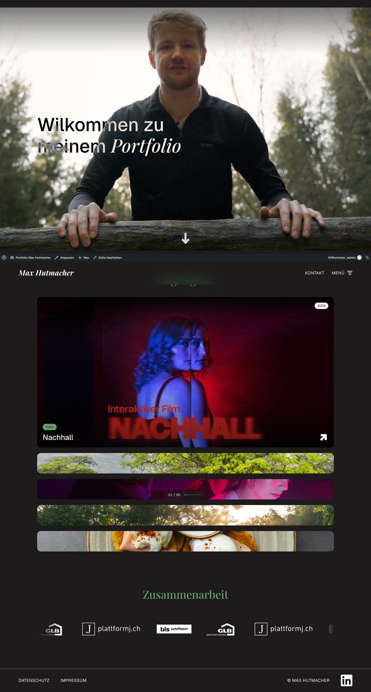 | 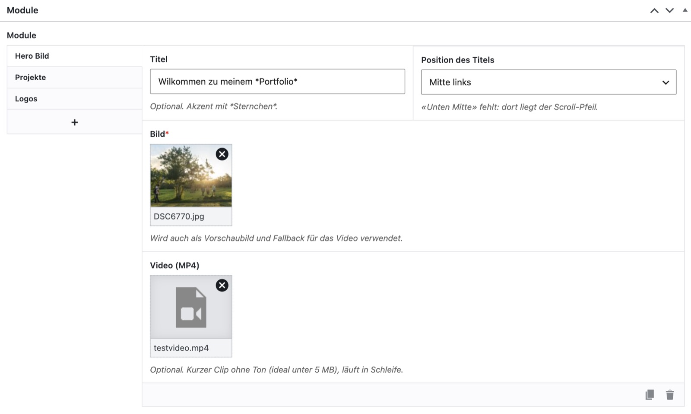   |

Highlights: Mausrad/Trackpad blättert durch die Projekte, das offene Projekt gleitet in die Bildschirmmitte. Die grüne Pille am Mauszeiger zeigt beim ersten Mal «Scrollen ↓», danach «Ansehen»; der Zähler «01 / 05» zeigt die Position.

### Projektseite
Hero (Titelbild/-video) → Eckdaten und Projektbeschrieb → Rolle und Teamabgrenzung → Video → Galerie. Alle Angaben kommen aus dem Post Type Projekt.

| Website | Backend |
|---|---|
| 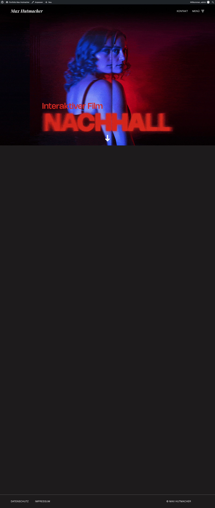 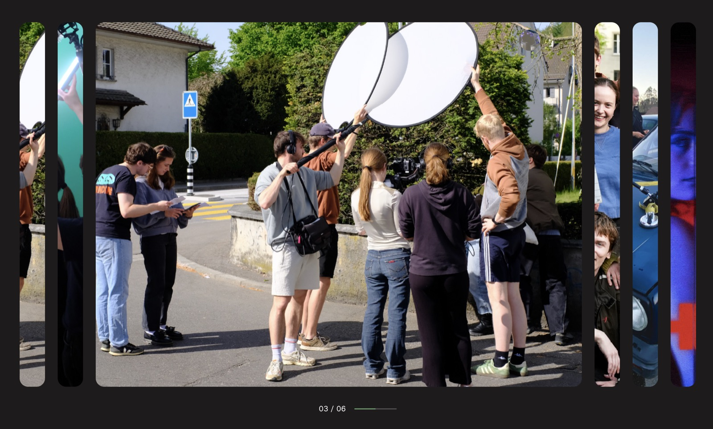 | 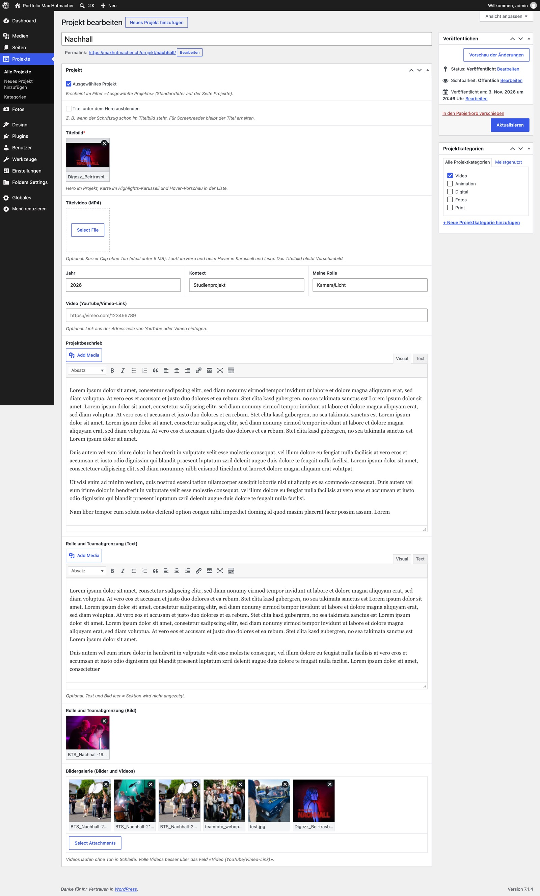 |

### Projekte (Directory)
Hero Text → Projekte (Liste) mit Filter «Ausgewählte Projekte» und Hover-Vorschau

| Website | Backend |
|---|---|
|  |  |

### Fotos
Fotogalerie mit Filter nach Fotokategorie; das Raster ergibt sich aus dem Bildformat

| Website | Backend |
|---|---|
|  |  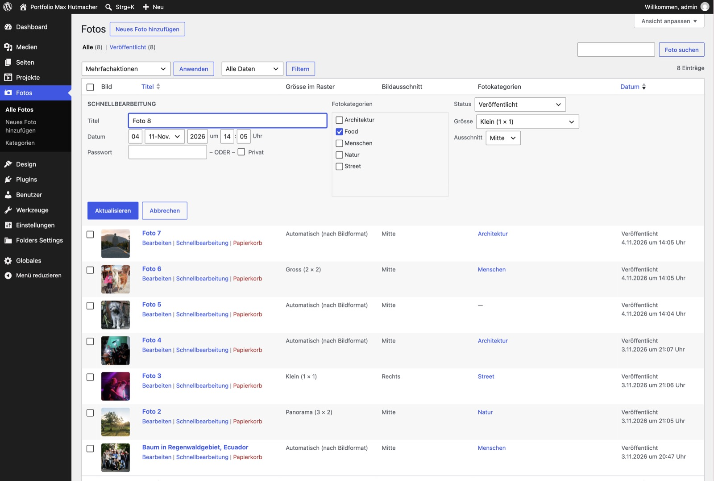 |

### Über mich
Hero Bild → Profil → Erfahrung

| Website | Backend |
|---|---|
|  |  |

### Kontakt
Hero Text mit kursivem Akzent (`*Kontakt*`) → Kontakt (E-Mail und Socials aus den Globals)

| Website | Backend |
|---|---|
|  |  |

### Navigation (Overlay-Menü)
Vollbild-Menü mit Hintergrund (gemeinsam oder pro Menüpunkt); Hover: Wort kursiv mit Text-Scramble, die anderen Punkte treten zurück

| Website | Backend |
|---|---|
|  |  Menüs mit Button «Alle aufklappen», Hintergrundbild und -video nebeneinander" width="400"> |

### Mobile
Header mit Signet, Menü-Symbol und Kontakt-Button (Milchglas); Highlights alle offen; Projektliste als Karten; Galerie zum Wischen mit angeschnittenem nächstem Bild und Punkten.

| Startseite | Menü | Projekte | Galerie |
|---|---|---|---|
| 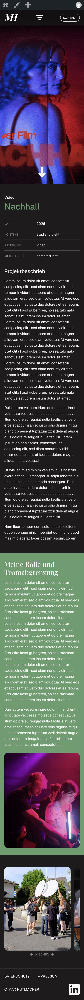 | 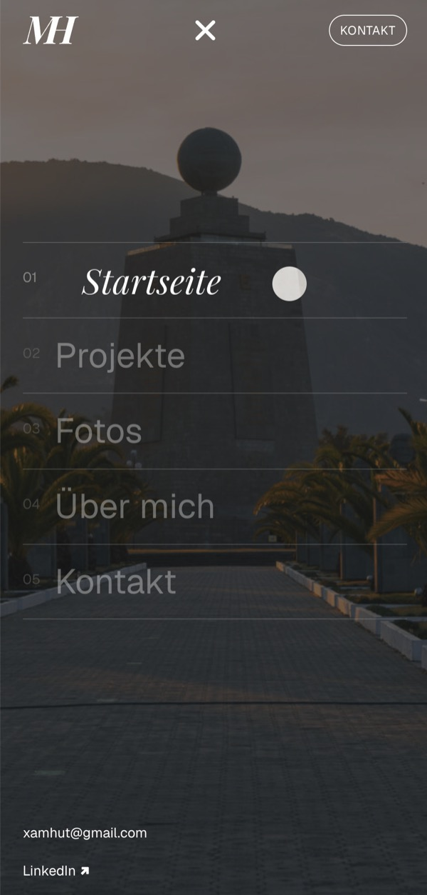 | 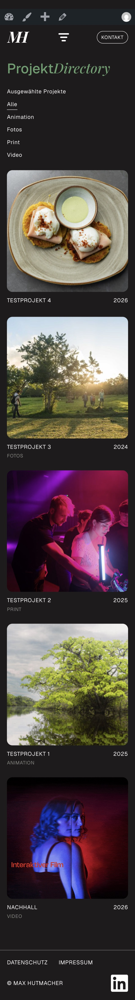 | 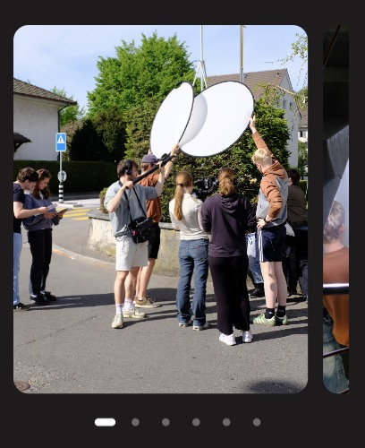 |

### Backend: Struktur
| Admin-Menü | Seitenübersicht | Impressum (Modul Text) |
|---|---|---|
|  |  |  |

### Backend: Globales
Website nur für angemeldete Benutzer (`site_private`), Logo und Signet, Copyright, E-Mail, Socials, gemeinsamer Menü-Hintergrund.

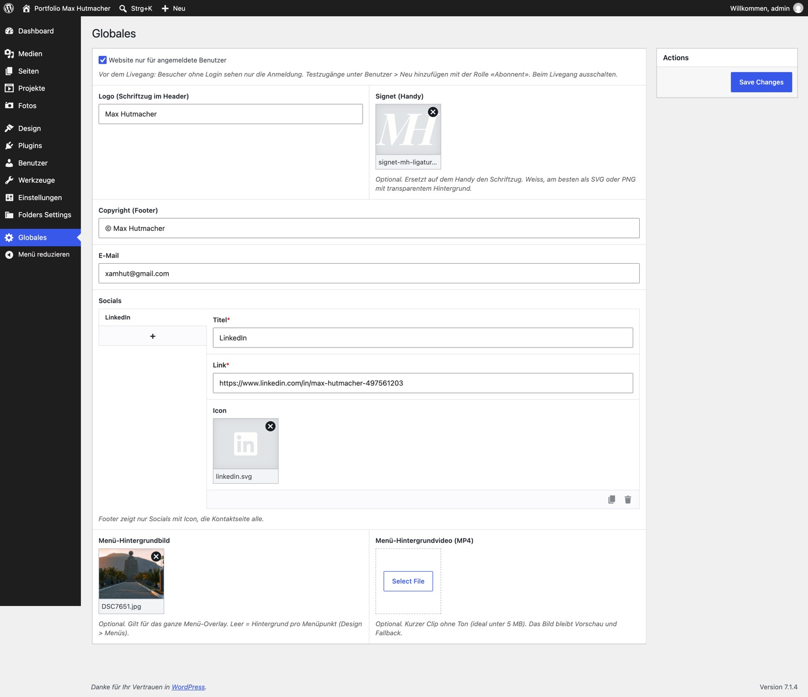

### Vorher: Stand mit dem Starter-Theme
Zum Vergleich der Stand vor der Umsetzung des CMS-Konzepts (Beispielmodule des Starter-Themes).

| Website | Backend |
|---|---|
|  |  |

### Zwischenstände Startseite
Entwicklung der Startseite: erste Umsetzung der Module, danach angepasst an das Screendesign (Figma), heute mit Overlay-Menü, Zentrieren und Cursor-Label (siehe oben).

| Erste Umsetzung | Nach Figma | Backend damals (Hero Bild ohne Titelposition) |
|---|---|---|
| 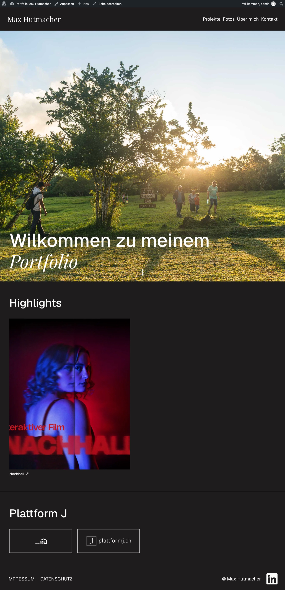 |  |  |

## Technische Umsetzung

### Aufbau
| Ordner | Inhalt |
|---|---|
| `backend/cpt/` | Custom Post Types `project` und `photo` |
| `backend/tax/` | Taxonomien `project_category` und `photo_category`, Begriffe werden einmalig automatisch angelegt |
| `backend/carbonfields/` | Inhaltsfelder (Carbon Fields) für Module, Projekte, Fotos und Globals |
| `backend/getter/` | Getter-Funktionen: Die Templates erhalten ihre Daten nur über diese Funktionen |
| `backend/helpers/` | Hilfsfunktionen (Medien, Videos, Rich Text, Titel-Akzent, Taxonomien) |
| `backend/init/` | Theme-Setup, Laden von Styles und Scripts (`wp_enqueue_*`) |
| `backend/admin/` | Anpassungen im WordPress-Backend, z. B. Vorschaubild und QuickEdit in der Fotoliste, Vorschaubilder und «Alle aufklappen» unter Design > Menüs |
| `frontend/views/` | Templates für Layout, Seiten, Module und wiederverwendbare Teile (z. B. `teaser/video.php`) |
| `frontend/scripts/main.js` | Filter, Videosteuerung, Hover-Vorschau im Directory |
| `docs/` | CMS-Konzept und Screenshots |

### Eingesetzte Technologien
- **Eigenes WordPress-Theme** (PHP) mit Custom Post Types, Taxonomien und Template-Hierarchie (`single-project.php`)
- **Carbon Fields** für die Inhaltsfelder und den Modulbaukasten
- **WP_Query / get_posts** für Projekte und Fotos, inkl. manueller Reihenfolge über ein Association-Feld
- **oEmbed** (WordPress-API) für YouTube und Vimeo, zwischengespeichert als Transient (1 Woche)
- **Vanilla JavaScript** (ES-Modul): IntersectionObserver für Videos, `requestAnimationFrame` für die Hover-Vorschau
- **CSS** mit Nesting, Grid, Scroll-Snap (Karussell), `aspect-ratio`, `:has()` und `clip-path`
- **View Transitions API** (`@view-transition`) für weiche Seitenwechsel

### Sicherheit, Performance und Barrierefreiheit
- Jede Ausgabe wird escaped (`esc_html()`, `esc_attr()`, `esc_url()`, `wp_kses_post()`); Video-Embeds werden mit `wp_kses()` auf ein `<iframe>` beschränkt.
- Bilder und Iframes mit Lazy Loading, Hero-Bilder mit `fetchpriority="high"`, Breite/Höhe gegen Layout-Sprünge.
- Videos laden erst bei Bedarf (`preload="none"`) und laufen nur, solange sie sichtbar sind.
- YouTube wird über `youtube-nocookie.com` eingebunden.
- Schriften (Geist, Playfair Display) sind lokal eingebunden: keine Verbindung zu Google Fonts, WOFF2 als variable Fonts, `font-display: swap`, Preload der sofort sichtbaren Schriften.
- Mit «Bewegung reduzieren» (`prefers-reduced-motion`) und auf Touch-Geräten wird statt Hover-Videos das Titelbild gezeigt.
- Filter-Buttons mit `aria-pressed`, unsichtbare H1 für Screenreader, wo der Titel Teil des Bildes ist.

## Setup
1. WordPress installieren (bei mir: Hostpoint).
2. Plugin **Carbon Fields** installieren und aktivieren.
3. Dieses Repository in `wp-content/themes/` ablegen (bei mir per FTP mit der VS-Code-Extension SFTP) und das Theme unter **Design > Themes** aktivieren.
4. **Einstellungen > Permalinks** einmal speichern, damit die Projekt-URLs (`/projekt/name/`) funktionieren.
5. **Einstellungen > Lesen**: «Eine statische Seite» wählen und die Startseite festlegen.
6. Unter **Globales** Logo, Copyright, E-Mail und Socials erfassen.
7. Seiten mit Modulen aufbauen (Reihenfolge siehe [CMS-Konzept](docs/cms-konzept.md), Abschnitt «Module pro Seite»).
8. Unter **Design > Menüs** die Menüs «Hauptnavigation» und «Rechtliches» anlegen und zuweisen.

> Zugangsdaten (`wp-config.php`, FTP) sind nicht im Repository. `.vscode/` ist in der `.gitignore`.

## Entwicklungsverlauf
| Datum | Schritt |
|---|---|
| 03.11.2026 | CMS-Konzept erstellt (Post Types, Taxonomien, Module, Menus, Globals) |
| 03.11.2026 | Grundstruktur nach Konzept: Post Types, Taxonomien, Felder, Getter, 9 Module, Projekt-Detailseite, Filter |
| 03.11.2026 | Projekt: YouTube/Vimeo-Embed (`video_url`) und Filter «Ausgewählte Projekte» (`featured`) |
| 04.11.2026 | Videos an allen Stellen: Hero, Karussell-Hover, Directory-Vorschau, Galerie |
| 04.11.2026 | Inhalte aller Seiten erfasst, README mit Screenshots |
| 04.11.2026 | Bugfix Carbon Fields: `value` ist reserviert, Steckbrief-Feld heisst neu `detail`; dunkler Seitenhintergrund und Footer immer am unteren Rand |
| 04.11.2026 | Design nach Figma (Startseite): Design-Tokens, Header/Footer, Hero, Highlights als Akkordeon (Hover), Farbumkehr des Hero-Texts über Video (`mix-blend-mode: difference`), Logo-Laufschrift (Endlos-Marquee) |
| 04.11.2026 | Cursor-Punkt (folgt der Maus, invertiert, grösser über Links), Hero immer bildschirmfüllend (inkl. Admin-Leiste), Scroll-Pfeil berechnet die Zielposition exakt |
| 04.11.2026 | Design nach Figma (Projekte): Directory zweispaltig (Filter links, Tabelle rechts), ganze Zeile anklickbar, grüner Hover, Vorschau 16:9 abgerundet; Active State für Navigation und Filter (`aria-current`, `aria-pressed`); Hero-Text-Titel grün, auf Kontakt weiss (`:has()`) |
| 04.11.2026 | Design nach Figma (Fotos): Raster mit 3 Spalten und fester Zeilenhöhe (Container-Query-Einheiten), Kachelgrösse und Bildausschnitt pro Foto wählbar (`grid_size`, `focus`), `srcset`/`sizes`; Backend-Liste mit Vorschaubild, Spalten für Grösse/Ausschnitt und QuickEdit |
| 04.11.2026 | Design nach Figma (Über mich): Profil und Erfahrung im gemeinsamen Raster (4 : 8 Spalten), Stationen zweispaltig, Steckbrief mit rechtsbündigen Werten, grüner Button; Oberkanten von Titel und Name bündig (`text-box-trim` mit Fallback über `cap`/`lh`) |
| 04.11.2026 | Design nach Figma (Projektseite): Titel und Eckdaten sichtbar unter dem Hero (ausblendbar mit `hide_title`), Projektbeschrieb zweispaltig (CSS `columns`), grüne Fläche für Rolle und Team, Galerie als horizontales Akkordeon (öffnet bei Hover im Format 3:2, Handy: Wischen mit Scroll-Snap) |
| 04.11.2026 | Impressum und Datenschutz (Vorlagen nach Schweizer DSG) im Stil der Seiten: Titel grün, Text max. 780 px, Zwischentitel H3 und H4 (Geist Bold), Links und Listen im Fliesstext |
| 07.11.2026 | Highlights per Mausrad/Trackpad: Scrollweg wird gesammelt (300 px pro Projekt, Mindestpause zwischen Schritten), erstes Projekt beim Laden offen, Video startet nach der Animation, Messung nur beim Laden (kein Ruckeln), `contain: layout paint`; Steckbrief: Werte mit Komma stehen untereinander |
| 07.11.2026 | Google Fonts lokal eingebunden (Datenschutz): 6 WOFF2-Dateien in `frontend/assets/fonts/`, `@font-face` mit `unicode-range`, Preload für Geist und Playfair Italic |
| 07.11.2026 | Neue Navigation (CMS-Konzept v04, Prototyp in `docs/prototypes/`): Header mit «Kontakt» und Menü-Button (`aria-expanded`, Striche werden zum X), Vollbild-Overlay mit `clip-path`, Menüpunkte mit Text-Scramble, Einrücken und Abdunkeln der anderen Punkte (`:has()`), Hintergrund pro Menüpunkt oder gemeinsam (Bild/Video, Felder am Menüeintrag `nav_menu_item` und in Globals), Bilder laden erst beim ersten Öffnen; Fokus-Steuerung mit `inert`, Esc, Scroll-Lock mit `scrollbar-gutter`; Backend «Design > Menüs» mit Vorschaubildern und «Alle aufklappen» |
| 07.11.2026 | Weiche Übergänge: Seitenwechsel per View Transitions API (Menü bleibt beim Klick offen, neue Seite blendet darüber), Inhalte blenden beim Scrollen ein (IntersectionObserver, gestaffelt) |
| 08.11.2026 | Header neu: fix auf allen Seiten, ohne Hintergrund, weicher Verlauf oben im Hero für die Lesbarkeit; blendet ab einer Bildschirmhöhe beim Runterscrollen aus und beim Hochscrollen wieder ein (gleiche Distanz auf allen Seiten, Scroll-Events per `requestAnimationFrame` gedrosselt). Ausprobiert und verworfen: Streifen-Hero aus dem Prototyp (doppelt die Navigation), Glas-Effekt über die ganze Breite, Farbumkehr (`mix-blend-mode`), Milchglas |
| 08.11.2026 | Filter (Projekte, Fotos) wechseln weich per View Transition innerhalb der Seite (Einträge gleiten an den neuen Platz); nachgeladene Bilder blenden nach dem Laden ein |
| 08.11.2026 | Hero Bild: Position des Titels im Backend wählbar (`title_position`, Raster 3 × 3 ohne «Unten Mitte», Standard «Mitte links»), weicher Verlauf oben im Hero |
| 08.11.2026 | Responsive: Projektliste auf dem Handy zweispaltig (Kategorie unter dem Titel), Hover nur mit Maus (`@media (hover: hover)`), Touch-Ziele 44 px (`pointer: coarse`), Header 72 px auf dem Handy, H1-Zwischengrösse fürs Tablet; Header mit Milchglas nach dem Hero (auf Tablet/Handy immer), Logo und Navigation optisch eingemittet (`text-box`); Ausblenden beim Scrollen wieder verworfen |
| 08.11.2026 | Tablet/Handy (bis 1024 px): Highlights alle aufgeklappt mit Infos, Galerie zum Wischen statt Akkordeon (`matchMedia`); Menü-Overlay ohne `visibility` (Safari); Signet statt Schriftzug auf dem Handy (`logo_signet` in Globals, SVG als ``) |
| 08.11.2026 | Header auf Tablet/Handy: Signet links, Menü-Symbol in der Mitte, «Kontakt» als umrandeter Button rechts (Raster `1fr auto 1fr`, `display: contents`); neues Menü-Symbol mit drei unterschiedlich langen Strichen, Animation zum X |
| 08.11.2026 | Typografie (kleinste Schrift 14 px, H1 mobil 40 px), Eckdaten als Datenblatt mit Linien; eigene Icon-Bibliothek (`frontend/assets/icons/`, `get_icon()`, Pfeile als abgerundete Flächen, Scroll-Pfeil mit Kontur → Füllung beim Hover); Galerie auf Tablet/Handy in voller Breite mit Punkten; aktiver Kontakt-Button ausgefüllt; Logos auf dem Handy grösser |
| 08.11.2026 | Hover nur mit Maus (keine hängenden Zustände auf Touch), Datenblatt-Stil auch für den Steckbrief, Logos mit gleicher Fläche (Höhe = Grösse ÷ √Seitenverhältnis), Projektliste auf dem Handy als Karten mit Vorschaubild 1:1; Galerie per Mausrad und Pfeiltasten blättern (wie Highlights); Bildformate auf dem Handy: Hochformat 4:5, Fotos einspaltig (1:1 / 4:5 / 3:2), `sizes` angepasst |
| 08.11.2026 | Vor dem Livegang: Website nur für angemeldete Benutzer (Schalter `site_private` in Globales, `template_redirect` + `auth_redirect()`, REST-API für Gäste gesperrt), Anwendungspasswörter abgeschaltet; Testzugang mit Rolle «Abonnent» |
| 08.11.2026 | Typografie und Abstände überarbeitet: Type-Scale (ca. 1.25) mit `clamp()`, neue Ebene H3, Zeilenlänge 68ch, Grossbuchstaben gesperrt; semantische Abstands-Tokens (`--space-stack-xs/s/m`, `--space-section`), Seitenrand fliessend; Kategorie-Pillen Schwarz auf Grün (WCAG AA); Highlights: Mausrad blättert ohne Seitenscrollen |
| 08.11.2026 | Admin-Leiste auf dem Handy fixiert (keine Lücke über dem Header), keine Admin-Leiste für Testzugänge; Markierfarbe im Akzent-Grün (`::selection`); Vimeo-Einbettungen mit `dnt=1` (keine Tracking-Cookies) |
| 08.11.2026 | Markierfarbe halbtransparent (`color-mix()`, 50 % Grün wie das Standard-Blau der Browser), auf der grünen Rollen-Fläche halbtransparentes Schwarz |
| 08.11.2026 | Overlay-Menü: «Start» als erster Punkt (in Design > Menüs), Schrift verkleinert sich automatisch bei vielen Punkten oder niedrigem Fenster (`--menu-count`, `min()` aus Breite und Höhe), gestaffelte Animation über `--i` statt fester `nth-child`-Regeln |
| 09.11.2026 | Highlights: offenes Projekt wird in die Mitte gescrollt, eigene Scroll-Animation mit `requestAnimationFrame` und derselben Kurve wie das Aufklappen (`cubic-bezier` in JS nachgebaut); Trackpad-Nachlauf (Momentum) erkannt, ein Wischer = ein Schritt; Cursor-Label als grüne Pille («Scrollen ↓» bis zum ersten Blättern, danach «Ansehen»; `sessionStorage`) und Zähler «01 / 05» mit Fortschrittslinie |
| 09.11.2026 | Galerie: gleiches Cursor-Label und Zähler (eingeblendet nur bei offenem Bild), Bilder ohne Zoom beim Aufklappen (feste Bildgrösse, Streifen deckt auf), Cursor-Punkt gross über interaktiven Elementen (`tabindex="0"`); Handy/Tablet: nächstes Bild angeschnitten (88 %) und Anleitung «← Wischen →» bis zum ersten Wischen |
| 09.11.2026 | Galerie: beim Aufklappen gleitet die ganze Galerie in die Bildschirmmitte (gleiche Dauer und Kurve wie das Aufklappen, `animateScrollTo`), «Maus hat verlassen» durch Scrollen wird ignoriert |
| 09.11.2026 | Handy/Tablet: Projekt in der Bildschirmmitte hervorheben (Projektliste und Highlights, gemeinsame Funktion `initScrollHighlight`), grüne Zeile beim Hover nur noch bei breitem Fenster; Einblenden beim Scrollen räumt nach der Animation auf (sonst überstimmt `fill-mode` andere Regeln) |
| 09.11.2026 | Neues Modul `intro` (Startseite nach dem Hero): kurze Vorstellung in grosser Schrift, färbt sich beim Scrollen Wort für Wort ein (Wörter per `TreeWalker` in ``, Fortschritt pro Wort als CSS-Variable `--lit`); Ursache «leere Startseite»: doppelte Seite «Startseite» unter Einstellungen > Lesen |
| 09.11.2026 | Intro: Schrift als eigene Stufe zwischen H3 und H2 (`--font-lead`, konkurriert nicht mit den Titeln), mehr Luft, mittig mit linksbündigem Text; Markierung mit `**doppelten Sternchen**` (`<mark>`), wird beim Scrollen von links nach rechts gezogen (Breite des Hintergrunds = `--lit`) |
| 09.11.2026 | Hero: flüssige Verzerrung unter der Maus mit leichtem Farbsaum (WebGL, eigene Shader, zwei Feld-Texturen im Wechsel «Ping-Pong»), auch mit Video; rechnet nur, solange sich die Maus bewegt; ohne Maus, WebGL oder bei «Bewegung reduzieren» unverändert |

## Learnings
<!-- In eigenen Worten ergänzen -->
<!-- Vorschlag (Typografie und Abstände): «Mit einer Type-Scale (Verhältnis ca. 1.25) und clamp() wachsen Schriften und Abstände fliessend mit der Bildschirmbreite, statt an Breakpoints zu springen. Semantische Abstands-Tokens (stack-xs/s/m, section) setzen das Gesetz der Nähe konsequent um: Was zusammengehört, steht näher beieinander. Der Kontrast-Check nach WCAG hat gezeigt, dass Weiss auf Grün (3.2 : 1) nicht reicht.» -->
<!-- Vorschlag (Bildformate Mobile): «Auf dem Handy wirken Hochformate (4:5) grösser als Querformate. Mit aspect-ratio und object-fit: cover lässt sich das Format pro Bildschirmgrösse festlegen, ohne andere Bilder hochzuladen; das Feld focus bestimmt per object-position den Ausschnitt. Wichtig: sizes im srcset an die neue Breite anpassen, sonst lädt der Browser zu kleine Bilder.» -->
- _Folgt._

## Schwierigkeiten
<!-- In eigenen Worten ergänzen -->
- _Folgt._

## Ressourcen
- IM5-Starter-Theme (Boilerplate, FHGR) und Anleitungen in [`manuals/`](manuals/)
- [WordPress Developer Resources](https://developer.wordpress.org/)
- [Carbon Fields Dokumentation](https://docs.carbonfields.net/)
- [MDN Web Docs](https://developer.mozilla.org/) (IntersectionObserver, `<video>`, CSS)
- [HandBrake](https://handbrake.fr/) zum Komprimieren der Videos
- Schriften [Geist](https://fonts.google.com/specimen/Geist) und [Playfair Display](https://fonts.google.com/specimen/Playfair+Display) von Google Fonts, Lizenz [SIL Open Font License 1.1](https://openfontlicense.org/)
- Referenz für das Directory: [houmahani.com/directory](https://houmahani.com/directory)
- KI-Unterstützung: Claude Code (Anthropic) als Coach und Pair-Programmer
